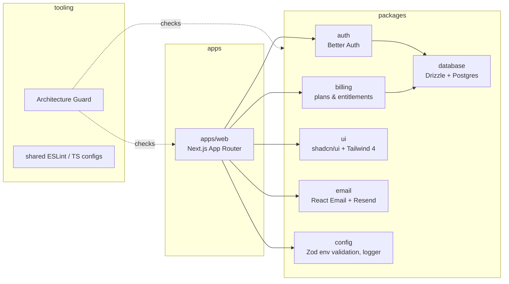

# jumpra

**A Next.js SaaS starter kit for EU teams that build with AI coding agents.**
The groundwork every multi-tenant SaaS needs is done – so you jump straight to your product.

`Next.js` · `React` · `TypeScript` · `Tailwind CSS` · `PostgreSQL` · `Drizzle` · `Better Auth` · `Stripe`

---

> **This is the public showcase repository.** jumpra is a commercial product, so its source code lives in a private repository. This page describes what it includes, how it is built and the engineering decisions behind it.
>
> **Status:** in active development · waitlist coming soon · last updated November 2026

---

## What it is

Most SaaS products start with the same weeks of work: sign-in, organizations, roles, billing, e-mails, a dashboard, deployment. jumpra ships all of that as a tested, documented monorepo, built so that AI coding agents (Claude Code, Cursor) can extend it safely without breaking tenant isolation or permissions.

## Features

**Always on (core)**
- Sign-in with e-mail and password, e-mail verification, password reset, magic links, passkeys, two-factor authentication and rate limiting
- Organizations with owner, admin and member roles, invitations and ownership transfer
- Tenant isolation: every query for tenant data runs through the organization's context
- An example tenant-scoped resource to build your own features on
- Audit log, data export and account/organization deletion
- Dashboard UI built on shadcn/ui and Tailwind CSS 4

**Optional modules** – stay off until their environment variables are set
- Stripe billing per organization: plans, limits, feature flags, optional per-seat pricing
- Stripe as seller of record (Stripe Managed Payments)
- Google and GitHub sign-in
- AI assistant per organization
- Cookieless analytics (Plausible, Umami or Pirsch)
- Error reporting to your monitoring
- Operator dashboard with revenue and customers across all organizations
- Postgres row-level security as a second safety net
- German interface and e-mails

A module that is off costs nothing at runtime, and turning it on later needs no merge.

**Built for AI coding agents**
- `AGENTS.md` / `CLAUDE.md` with project rules
- Agent skills, e.g. *add a tenant-scoped resource*, *add a permission*, *add a plan feature*
- Cursor rules pointing to the same conventions

## Why "for EU teams"

Selling software in Europe brings extra work that most starter kits leave to you. jumpra prepares the technical side:

- **VAT handled by Stripe** – with Stripe Managed Payments, Stripe sells to your customers as seller of record and calculates, collects and remits indirect taxes such as VAT
- **Privacy-friendly analytics** – cookieless trackers, including EU-hosted or self-hosted options
- **Data subject features built in** – data export, account and organization deletion and an audit log are part of the core
- **German out of the box** – interface and e-mails can be switched to German
- **Self-hostable** – a Docker reference deployment runs on any server, including EU hosting

jumpra gives you the technical building blocks; whether your product meets legal requirements such as the GDPR is still something to have checked for your case.

## Quality and security

jumpra treats safety checks as part of the product, not an afterthought:

- **Security test suite in CI** – tenant isolation, RBAC, billing and webhook handling, backed by a documented security catalog that states what is covered and where the limits are
- **Architecture Guard** – one command that runs type-checking, ESLint, import-boundary rules and custom checks, so agents (and humans) can't silently break the architecture
- **Testing pyramid** – Vitest unit and integration tests against a real Postgres, Playwright end-to-end tests against a production build
- **Drift checks** – CI fails if database schema or migrations are out of date, if documented env variables are missing, or if build output is incomplete
- **Validated configuration** – all environment variables are checked with Zod at startup

## Architecture

| Area | Choice |
|:--|:--|
| Monorepo | pnpm workspaces + Turborepo |
| App | Next.js (App Router), React, TypeScript |
| UI | shadcn/ui (Base UI), Tailwind CSS 4 |
| Data | PostgreSQL, Drizzle ORM, versioned migrations |
| Auth | Better Auth (e-mail/password, OAuth, organizations) |
| Billing | Stripe, plan config with `getEntitlements()` / `can()` |
| E-mail | React Email templates, Resend adapter, local log adapter |
| Testing | Vitest, Playwright |
| Deployment | Docker reference deployment with Postgres and Caddy |

## Engineering decisions

- **Modules off by default.** Optional features only activate when their variables are set, so a fresh project starts small and you only configure what you use.
- **Tenant isolation is tested, not assumed.** Security tests in CI check that data and permissions stay within an organization.
- **Rules that machines can check.** Conventions are encoded as lint rules and import boundaries rather than only written down – that is what makes AI-assisted development on top of the kit safe.
- **Separate buyer export.** Internal planning and docs stay in the development repository; buyers receive a clean, documented release with a changelog and upgrade notes.

## Interested?

jumpra is not on sale yet. If you'd like to hear when it launches, or want to talk about it, write to [thomas.hermanu@gmail.com](mailto:thomas.hermanu@gmail.com?subject=jumpra). A waitlist page is coming soon.

## Built by

**Thomas Hermanu** – Frontend-focused Full-Stack Engineer (React, TypeScript), Ho Chi Minh City
[LinkedIn](https://www.linkedin.com/in/thomashermanu/) · [GitHub](https://github.com/tmh9x)

Happy to walk through the code in an interview – just ask.
